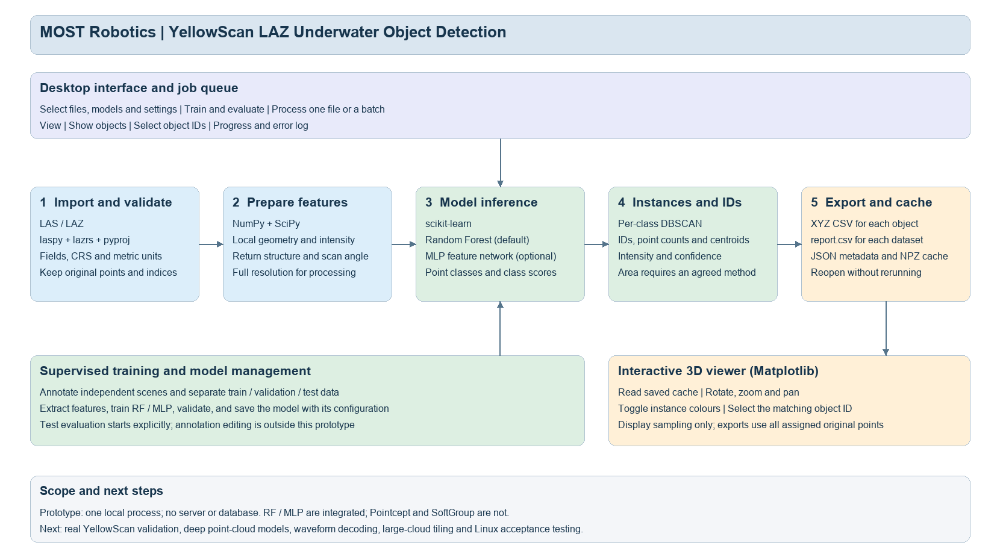

# Object Detection

A small offline desktop prototype for detecting and separating underwater objects in georeferenced YellowScan LAS/LAZ point clouds. The current implementation uses a Random Forest baseline, an optional MLP feature network, and per-class DBSCAN instance grouping.

This is a research prototype. Real YellowScan detection performance, waveform processing and Linux deployment have not yet been validated. Pointcept and SoftGroup are assessed as future options; neither is integrated.

## Software architecture



The architecture is fully editable in [diagrams.net](docs/MOST_Software_Architecture_EN.drawio). An [SVG version](docs/MOST_Software_Architecture_EN.svg) and [architecture notes](docs/Software_Architecture.md) are included.

## Installation

Python 3.11 is required. The interface uses PySide6 (Qt) with an embedded Qt WebEngine 3D view, installed from `requirements.txt` (about 300 MB download). Processing and the 3D view run fully offline afterwards.

On Windows, run `install_windows.cmd`, then `start_windows.cmd`.

On Linux, install Python 3.11 and venv (Qt WebEngine also needs the usual desktop libraries such as `libnss3` and `libxkbcommon`), then run:

```sh
sh install_linux.sh
sh start_linux.sh
```

A graphical desktop is required. The source supports both platforms, but only the Windows workflow has been checked in this delivery. This is a source package rather than a standalone EXE.

## Synthetic demonstration

From the project directory after installation, generate and train an explicitly synthetic demonstration:

```powershell
.venv\Scripts\python.exe create_demo.py synthetic_demo --train-and-run
```

On Linux, use `.venv/bin/python` instead. Start the application and click **Synthetic demo**. The button opens the saved demonstration result; it does not run training automatically. Use a new destination name when regenerating the data.

The demonstration contains no real YellowScan measurements. Its trained model and metrics provide no evidence of real-world underwater recognition performance.

## Metal targets demonstration (real scenes, simulated targets)

The intended targets are square metal plates and metal spheres under about 1 m, lying on or partly buried in a riverbed. No real target data exist yet, so `synthetic_targets.py` places simulated targets on the riverbed (LAS class 40) of real YellowScan Navigator scenes and records where they are:

```sh
.venv/bin/python synthetic_targets.py metal_demo --train-and-run
```

It needs the public sample files (path set in `DATA` in the script) and takes a few minutes. Three crops are written: Saint-Bauzille A (train, 70 targets), Saint-Bauzille B (validation, 30) and Devil's Bridge (test, 40), each as `<scene>.laz`, `<scene>.labels.csv` and `<scene>.truth.json`. Each target is sampled on the side the scanner sees, with the local riverbed point density, 2–3 cm range noise, a brighter but noisy intensity, return attributes copied from nearby bottom points, imperfect vendor classes (mostly 40, some 45 and 1), the riverbed underneath removed, and a few water-column returns above it. Click **Metal targets demo** to open the result.

On Devil's Bridge, the saved demonstration finds 24 of 40 targets with 3 false alarms, using threshold 0.6, cluster radius 0.3 m and at least 8 points per object. Detection depends mainly on how many laser points land on a target: 22 of 24 targets with at least 20 points were found, but only 2 of 16 with fewer. These numbers show that the workflow runs. Simulated targets are not evidence of real-world performance.

## LAS classes

Input classes follow ASPRS LAS 1.4, including the topo-bathymetric codes YellowScan uses: 1 unassigned, 2 ground, 7 low noise, 40 bathymetric bottom, 41 water surface, 45 water column, and others. The model uses them as inputs (bottom, water surface, water column, ground, noise), together with each point's height above the local riverbed, estimated from class 40 points.

Every class number in the program is an ASPRS code; there is no separate numbering. A manifest lists only its target classes, for example `{"64": "metal_plate", "65": "metal_sphere"}`. A target class must be a defined ASPRS class other than 0 and 1 (for example 43 submerged object) or a user-definable code 64–255. Reserved codes (such as 8, 12, 23–39 and 46–63) are rejected. There is no background class: points that are not targets keep their own LAS class. The model uses 0 internally for "not a target", but never writes it to a file.

The metal demonstration uses **64 = metal plate** and **65 = metal sphere**. The standard code 43 means a submerged object without further detail, so it cannot separate plates from spheres.

Each processed file gets `classified.laz`, a copy of the input with every attribute kept. Points in a detected object get that object's target class; all other points keep their input class. An extra dimension `object_instance` holds the object number (0 = none). Point formats 0–5 store only classes 0–31, so they are upgraded to the matching LAS 1.4 format (6, 7, 9 or 10) when a target code is larger.

Training labels are LAS codes too. In a `point_index,class_id` CSV, a target class marks a target point. Any other code (0, 2, 40, …) marks a point that is not a target, and a blank value or -1 means unlabelled. Labels can also be a LAS/LAZ file: mark target points with their target class (for example in CloudCompare) and set the manifest's `labels` to that file.

## Ground-truth evaluation

When an input `scene.laz` has `scene.truth.json` next to it, processing compares the detected objects with the known targets and saves `evaluation.json`. A detection and a target are matched one-to-one, highest point overlap first, when they share at least a quarter of their combined points (point IoU ≥ 0.25). The window then shows how many targets were found, false alarms, wrong classes, mean IoU, centre error and the missed target IDs; the table gets a **Ground truth** column. In the 3D view, colour by **Truth** to see detected, false-alarm and missed points, or type a target ID such as `T004` in the find box. Colour by **LAS class** to see the input classes.

A truth file lists `point_count` and `objects`; each object has `object_id`, `class_id`, `class_name`, `center` and either `point_range` (`[start, stop)`) or `point_indices`.

## Real data workflow

1. Export appropriately georeferenced and corrected LAS/LAZ data from CloudStation. The prototype does not process YellowScan RAW, reconstruct trajectories or perform underwater refraction correction.
2. Confirm that X, Y and Z are in metres. Supply the known projected CRS if it is absent from the LAS header. This setting records the CRS and does not reproject coordinates. Geographic or non-metric horizontal coordinates are rejected.
3. Prepare labels in `point_index,class_id` CSV files, or as a LAS/LAZ file (see [LAS classes](#las-classes)). Indices refer to the original zero-based point-record order. Class IDs are ASPRS LAS codes (see [LAS classes](#las-classes)): a manifest target class marks a target, any other code marks a non-target point, and blank or -1 means unlabelled. External annotation tools must preserve or recover this mapping.
4. Create a dataset manifest using `manifest_example.json`. Separate independent scenes or non-overlapping regions into train, validation and test sets. Use the same `scene_id` for overlapping data; the software checks duplicate paths, identical file content and cross-split scene IDs, but cannot prove that different files do not overlap spatially. Random-forest classes are weighted by inverse frequency unless the manifest sets `"balance_classes": false`.
5. Select the manifest in **Train and Evaluate**, choose a backend and training iterations, and save a new model. Every target class, and some non-target points, must appear in the training labels. Validation metrics and model settings are saved alongside the model. Test labels are used only when **Evaluate held-out test set** is clicked.
6. In **Process and View**, select a trusted trained model, one or more input files, and a results directory. Files run sequentially; a failed file does not stop the remaining batch.
7. The object table (left) lists every detected object; click a heading to sort. The 3D view (right) is part of the window. Click an object in the table to fly to it in 3D, or click a point in 3D to select its object in the table. **Open in browser** shows the same view in a web browser. Saved results can be reopened without rerunning inference or reading the original input file.

## Outputs and definitions

Each run creates `<first_input_stem>_<YYYYMMDD_HHMMSS>`, using the computer's local run-start time. Metadata records the timezone. Existing directories receive a unique suffix.

```text
run_directory/
  run_metadata.json
  objects/
    D0001_O00001.csv
  datasets/
    D0001/
      report.csv
      objects.json
      view3d.html
      classified.laz
      evaluation.json   (only with ground truth)
      status.json
```

Each dataset report preserves the proposed requirements header:

```text
object ID,x,y,z,Nr_of_points,Intensity,Area,confidence
```

- **Coordinates** are the arithmetic mean of all original points assigned to the exported instance. They are not necessarily the physical object's centre.
- **Nr_of_points** is the number of rows in that object's XYZ CSV.
- **Intensity** is the mean recorded raw LAS intensity. Scaling is not radiometric or water-attenuation correction. An all-zero input is flagged and retained as recorded.
- **Area** is blank by default (`unresolved`). An explicitly selected `convex_hull_xy` computes the horizontal convex-hull footprint in square metres. It fills concavities and holes and is not 3D surface area. The method needs project approval before acceptance.
- **Confidence** is the mean winning-class probability of the points assigned to the final instance. It is uncalibrated and is not measured detection accuracy.

Processing and CSV export use original points without downsampling. Each processed file also gets `view3d.html`, an offline page that draws up to 3,000,000 points with the GPU (WebGL); object points get at least half of that budget. It is shown inside the application (and can be opened in a browser). Drag to rotate, right-drag to pan, scroll to zoom, click a point to identify its object, or type an object ID to jump to it. Measured on Devil's Bridge: 3 M points render in about 3–5 ms per frame. The page is about 22 bytes per shown point, so up to about 66 MB. Display sampling does not change inference, object coordinates, reports or CSV exports. Results saved by earlier versions (with `view.npz`) still open; their 3D view shows the 30,000 cached points. Object IDs match across the report, object files and 3D view. Source mapping is retained through per-dataset reports and metadata. CSV is UTF-8 with a BOM; missing values use blank cells and JSON nulls.

## Scope and limits

By default there is no point limit (Max points / file = 0): every point of every file is processed. A positive value restores an explicit per-file and per-labelled-split cap. A file is refused before decoding only if its estimated memory (about 600 bytes per point) exceeds 80% of physical RAM; split such files by area first. Feature extraction, classification and clustering use all CPU cores. Clustering is a chunked DBSCAN whose memory is bounded by chunk size; core points and clusters match scikit-learn's DBSCAN, and each border point joins the cluster of its nearest core point. Measured on a 10-core, 64 GB Mac with a 100-tree random forest: 7.3 M points (Devil's Bridge LAZ) 33 s, 7.5 M points (Barsebäck LAS) under 32 s, 14.7 M points (Saint-Bauzille LAS) 81 s, peak memory 2.7–5.5 GB.

The MLP is a three-hidden-layer network on engineered features (64/64/32), not an end-to-end PointNet or Pointcept model. Local height uses the neighbourhood Z 10th percentile, not a reconstructed seabed. DBSCAN can merge nearby same-class objects or split sparse objects. Each file is clustered globally, avoiding within-file tile seams; overlapping input files are not reconciled with each other.

Full-waveform samples are not decoded or used. The importer records some waveform fields, flags and same-stem `.wdp` existence; this does not establish that linked waveform samples are complete or decodable. No annotation editor, cancellation, checkpoint resume or production packaging is included. Load only trusted locally generated `.joblib` models.

## Requirements and method assessment

- [Original English requirements v0.2](preparation/MOST_Robotics_Requirements.txt)
- [GitHub method assessment](docs/Model_Assessment.md)
- [English data notes](docs/YellowScan_Data_Notes.md)
- [Functional validation record](docs/Validation.txt)

All four supplied `preparation` files are preserved unchanged in `preparation/`. This includes the original Chinese source report and Chinese requirements translation. Client-facing software, current architecture and explanatory documentation are in English. The original supplied architecture is a legacy source document; use the current architecture in `docs/` for this implementation.

## Verification

```powershell
.venv\Scripts\python.exe -m unittest -v
```

Ten workflow tests cover LAZ reading, training and model reload, relocated model/data references, MLP availability, batch failure isolation, no-object results, IDs and exported original points, point counts, centroids, known-area geometry, split leakage checks and coordinate translation invariance. These are functional checks, not a real-world detection benchmark.

The application window and heading are named **Object Detection**. The interface keeps labels short (format details are in hover tooltips); model limitations are documented here. The model uses scikit-learn RandomForestClassifier by default, or StandardScaler plus MLPClassifier (64/64/32), followed by per-class DBSCAN grouping. There is no pretrained real-survey model bundled.
