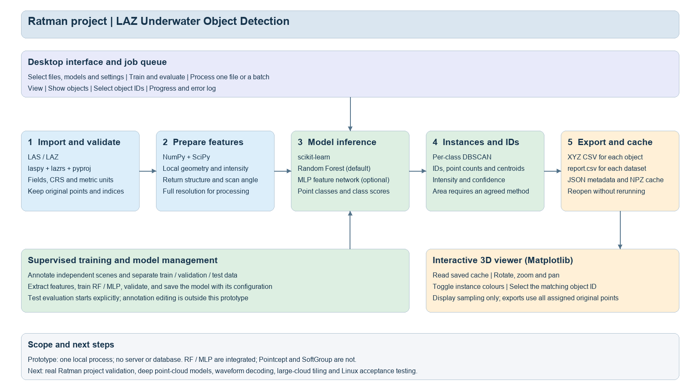

# Ratman project

Object Detection

A small offline desktop prototype for detecting and separating underwater objects in georeferenced Ratman project LAS/LAZ point clouds. The current implementation uses a Random Forest baseline, an optional MLP feature network, and per-class DBSCAN instance grouping.

This is a research prototype. Real Ratman project detection performance, waveform processing and Linux deployment have not yet been validated. Pointcept and SoftGroup are assessed as future options; neither is integrated.

## Software architecture



The architecture is fully editable in [diagrams.net](docs/Ratman_Project_Software_Architecture_EN.drawio). An [SVG version](docs/Ratman_Project_Software_Architecture_EN.svg) and [architecture notes](docs/Software_Architecture.md) are included.

## Installation

Python 3.11 and Tk are required. The Windows python.org installer normally includes Tk. Initial installation downloads the pinned dependencies in `requirements.txt`; processing runs locally afterwards.

On Windows, run `install_windows.cmd`, then `start_windows.cmd`.

On Linux, install Python 3.11, venv and the appropriate Tk package for your distribution, then run:

```sh
sh install_linux.sh
sh start_linux.sh
```

A graphical desktop is required. The source supports both platforms, but only the Windows workflow has been checked in this delivery. This is a source package rather than a standalone EXE.

## Synthetic demonstration

From the project directory after installation, generate and train an explicitly synthetic demonstration:

```powershell
.venv\Scripts\python.exe create_demo.py synthetic_demo --train-and-run
```

On Linux, use `.venv/bin/python` instead. Start the application and click **Synthetic demo**. The button opens the saved demonstration result; it does not run training automatically. Use a new destination name when regenerating the data.

The demonstration contains no real Ratman project measurements. Its trained model and metrics provide no evidence of real-world underwater recognition performance.

## Real data workflow

1. Export appropriately georeferenced and corrected LAS/LAZ data from CloudStation. The prototype does not process Ratman project RAW, reconstruct trajectories or perform underwater refraction correction.
2. Confirm that X, Y and Z are in metres. Supply the known projected CRS if it is absent from the LAS header. This setting records the CRS and does not reproject coordinates. Geographic or non-metric horizontal coordinates are rejected.
3. Prepare labels in `point_index,class_id` CSV files. Indices refer to the original zero-based point-record order. Class 0 is background, positive integers are target classes, and blank or -1 means unlabelled. External annotation tools must preserve or recover this mapping.
4. Create a dataset manifest using `manifest_example.json`. Separate independent scenes or non-overlapping regions into train, validation and test sets. Use the same `scene_id` for overlapping data; the software checks duplicate paths, identical file content and cross-split scene IDs, but cannot prove that different files do not overlap spatially.
5. Select the manifest in **Train and Evaluate**, choose a backend and training iterations, and save a new model. Every declared class must appear in the training labels. Validation metrics and model settings are saved alongside the model. Test labels are used only when **Evaluate held-out test set** is clicked.
6. In **Process and View**, select a trusted trained model, one or more input files, and a results directory. Files run sequentially; a failed file does not stop the remaining batch.
7. Click **View**, toggle **Show objects**, and select an object ID in the list. Left drag rotates, middle drag pans, and right drag zooms. Saved results can be reopened without rerunning inference or reading the original input file.

## Outputs and definitions

Each run creates `<first_input_stem>_<YYYYMMDD_HHMMSS>`, using the computer's local run-start time. Metadata records the timezone. Existing directories receive a unique suffix.

```text
run_directory/
  run_metadata.json
  objects/
    D0001_O00001.csv
  datasets/
    D0001/
      report.csv
      objects.json
      view.npz
      status.json
```

Each dataset report preserves the proposed requirements header:

```text
object ID,x,y,z,Nr_of_points,Intensity,Area,confidence
```

- **Coordinates** are the arithmetic mean of all original points assigned to the exported instance. They are not necessarily the physical object's centre.
- **Nr_of_points** is the number of rows in that object's XYZ CSV.
- **Intensity** is the mean recorded raw LAS intensity. Scaling is not radiometric or water-attenuation correction. An all-zero input is flagged and retained as recorded.
- **Area** is blank by default (`unresolved`). An explicitly selected `convex_hull_xy` computes the horizontal convex-hull footprint in square metres. It fills concavities and holes and is not 3D surface area. The method needs project approval before acceptance.
- **Confidence** is the mean winning-class probability of the points assigned to the final instance. It is uncalibrated and is not measured detection accuracy.

Processing and CSV export use original points without downsampling. New display caches contain at most 30,000 deterministically sampled original points, preserving an example of each detected instance where the budget permits. The viewer offers 1,000, 5,000, 10,000 or 30,000 display points; click Apply after choosing. Display sampling does not change inference, object coordinates, reports or CSV exports. Oversized legacy caches are rejected before decompression and must be regenerated. Object IDs match across the report, object files and viewer cache. Source mapping is retained through per-dataset reports and metadata. CSV is UTF-8 with a BOM; missing values use blank cells and JSON nulls.

## Scope and limits

The default limit is 500,000 points per input file and per labelled split. The settings permit up to 2,000,000, but that scale has not been benchmarked. Oversized inputs fail explicitly. Dense clustering neighbourhoods are also rejected to bound memory usage.

The MLP is a three-hidden-layer network on engineered features (64/64/32), not an end-to-end PointNet or Pointcept model. Local height uses the neighbourhood Z 10th percentile, not a reconstructed seabed. DBSCAN can merge nearby same-class objects or split sparse objects. Each file is clustered globally, avoiding within-file tile seams; overlapping input files are not reconciled with each other.

Full-waveform samples are not decoded or used. The importer records some waveform fields, flags and same-stem `.wdp` existence; this does not establish that linked waveform samples are complete or decodable. No annotation editor, cancellation, checkpoint resume or production packaging is included. Load only trusted locally generated `.joblib` models.

## Requirements and method assessment

- [English requirements v0.2](preparation/Ratman_Project_Requirements.txt)
- [GitHub method assessment](docs/Model_Assessment.md)
- [English data notes](docs/Ratman_Project_Data_Notes.md)
- [Functional validation record](docs/Validation.txt)

The four supplied `preparation` documents are included in `preparation/` with project names updated to Ratman project. This includes the original Chinese source report and Chinese requirements translation. Client-facing software, current architecture and explanatory documentation are in English. The original supplied architecture is a legacy source document; use the current architecture in `docs/` for this implementation.

## Verification

```powershell
.venv\Scripts\python.exe -m unittest -v
```

Ten workflow tests cover LAZ reading, training and model reload, relocated model/data references, MLP availability, batch failure isolation, no-object results, IDs and exported original points, point counts, centroids, known-area geometry, split leakage checks and coordinate translation invariance. These are functional checks, not a real-world detection benchmark.

The application window and heading are named **Object Detection**. Its short introduction describes the workflow; model limitations remain documented here. The model uses scikit-learn RandomForestClassifier by default, or StandardScaler plus MLPClassifier (64/64/32), followed by per-class DBSCAN grouping. There is no pretrained real-survey model bundled.
